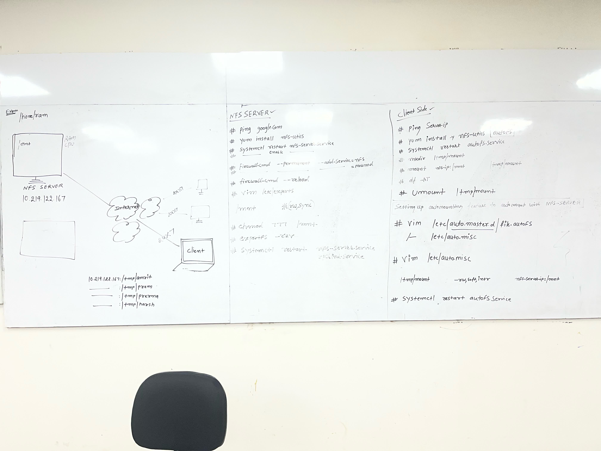

# NFS (Network File System) — RHCSA Notes

RHCSA Practical + Revision Notes

## **1. What is NFS?**

NFS (Network File System) is a network protocol that allows a Linux server to share directories with other computers over a network.

- NFS Server: Shares directories.
- NFS Client: Accesses shared directories.
- Default port: `2049/TCP` (NFSv4).
- Package: `nfs-utils`
- Service: `nfs-server.service`

**Important :  we make mount point in NFC client/(our system) of an particular directory of NFS server**

Example: A server shares `/srv/nfs/shared`, and a client accesses its files through `/mnt/nfs/shared` without copying the data locally.

!download.svg

                                       Server directory      →     Network       →       Client mount point

→ now if do any changes like creating files or whatever in */mnt/nfs/shared* it will automatically reflect in NFS server

## **2. Configure NFS Server (if NFS server is also rhel)**

Run these commands on the server (`10.219.122.167`).

Step 1 — Install package

```bash
dnf install -y nfs-utils
```

Step 2 — Start and enable service

```bash
systemctl enable --now nfs-server
```

- `-now` starts the service immediately and enables it for future boots.

Step 3 — Configure firewall

```bash
firewall-cmd --permanent --add-service=nfs
firewall-cmd --reload
```

Allows NFS traffic through the firewall. 

Step 4 — Configure shared directory

```bash
mkdir -p /srv/nfs/shared
vim /etc/exports
```

Add:

```bash
/srv/nfs/shared 10.219.122.0/24/(or your client IP)(rw,sync,root_squash,no_subtree_check)
```

This shares `/srv/nfs/shared` with clients in the specified subnet.

| Option | Meaning |
| --- | --- |
| `rw` | Allow reading and writing |
| `ro` | Read-only access |
| `sync` | Commit writes to stable storage before replying |
| `root_squash` | Map remote root to an unprivileged identity |
| `no_root_squash` | Disable root squashing — security risk |
| `no_subtree_check` | Disables subtree checking |
| `*` | Allow any client — avoid on untrusted networks |

Important: `/etc/exports` controls NFS sharing, not ordinary Linux filesystem permissions. For a writable share, configure suitable ownership and permissions as well. Avoid `chmod 777 /srv/nfs/shared` except in an isolated throwaway lab.

Step 5 — Apply exports

```bash
exportfs -rav
```

- `r` — Re-export directories.
- `a` — All exports.
- `v` — Verbose output.

**Remember** : Whenever you modify `/etc/exports`, run `exportfs -rav` to apply the changes.

Step 6 — Verify

```bash
exportfs -v
systemctl status nfs-server
```

These check the exported directories and server status.

## 3. Configure NFS Client (Manual Mounting)

Run on the client.

Step 1 — Install package

```bash
dnf install -y nfs-utils
```

Step 2 — Create mount point

```bash
mkdir -p /mnt/nfs/shared
```

Step 3 — Mount NFS share

```bash
mount -t nfs 10.219.122.167:/srv/nfs/shared /mnt/nfs/shared
```

Explanation:

| Part | Meaning |
| --- | --- |
| `mount` | Attach a filesystem |
| `-t nfs` | Filesystem type |
| `10.219.122.167` | NFS server IP |
| `:/srv/nfs/shared` | Shared server directory |
| `/mnt/nfs/shared` | Local client mount point |

Step 4 — Verify

```bash
df -hT /mnt/nfs/shared  # Verify NFS filesystem and mount details.
mountpoint /mnt/nfs/shared # Verify the directory is a mount point.
ls /mnt/nfs/shared
```

Step 5 — Unmount

```bash
umount /mnt/nfs/shared
```

## 4. Permanent NFS Mount Using /etc/fstab

For a mount that should persist across reboots:

```bash
vim /etc/fstab
```

Add:

```
10.219.122.167:/srv/nfs/shared /mnt/nfs/shared nfs defaults,_netdev 0 0
```

Then:

```bash
mount -a # Mount all configured filesystems
findmnt /mnt/nfs/shared # Verify the mount
```

`_netdev` identifies the mount as network-dependent, allowing systemd to handle it appropriately during startup.

## **5. AutoFS — Automatic On-Demand Mounting**

AutoFS automatically mounts NFS shares when accessed and can unmount them after inactivity.

Unlike a regular `/etc/fstab` NFS mount, AutoFS does not need to keep the remote share continuously mounted.

**Configure AutoFS on Client :** Make sure `/mnt/nfs/shared` is not already manually mounted.

Step 1 — Install AutoFS

```bash
dnf install -y autofs nfs-utils
```

Step 2 — Configure master map

```bash
vim /etc/auto.master.d/nfs.autofs
```

Add:

```
/- /etc/auto.nfs
```

- `/-` → Direct mapping.
- `/etc/auto.nfs` → File containing mount configurations.

Step 3 — Configure NFS map

```bash
vim /etc/auto.nfs
```

Add: 

```
/mnt/nfs/shared -fstype=nfs,rw 10.219.122.167:/srv/nfs/shared
```

| Part | Meaning |
| --- | --- |
| `/mnt/nfs/shared` | Local mount point |
| `-fstype=nfs` | NFS filesystem |
| `rw` | Request read/write access |
| `10.219.122.167:/srv/nfs/shared` | NFS server and exported directory |

Step 4 — Start AutoFS

```bash
systemctl enable --now autofs
systemctl restart autofs
```

Step 5 — Test automounting

```
ls /mnt/nfs/shared
findmnt -t nfs,nfs4
```

Accessing `/mnt/nfs/shared` triggers the NFS mount.

Note: Your teacher used `/etc/auto.misc`, which can work, but a separate `/etc/auto.nfs` is cleaner. Files inside `/etc/auto.master.d/` must have the `.autofs` extension to be included automatically.

## 6. Important NFS Commands — Quick Revision

| Command | Purpose |
| --- | --- |
| `exportfs -v` | Display exported directories |
| `exportfs -rav` | Reload export configuration |
| `mount -t nfs` | Manually mount NFS |
| `umount` | Unmount filesystem |
| `findmnt -t nfs,nfs4` | Show NFS mounts |
| `df -hT` | Show mounted filesystem types and sizes |
| `systemctl status nfs-server` | Check NFS server |
| `systemctl status autofs` | Check AutoFS |

## 7. RHCSA Practice Challenge

Try this without looking at the commands:

Practice checklist

0/6

- [ ]  Configure an NFS server to export /srv/nfs/shared.
- [ ]  Allow only the 10.219.122.0/24 subnet.
- [ ]  Mount the share manually on a client at /mnt/nfs/shared.
- [ ]  Unmount it and configure AutoFS direct mapping.
- [ ]  Verify that accessing /mnt/nfs/shared triggers the NFS mount.
- [ ]  Ensure AutoFS starts automatically after reboot.

Answer(1/6): (Q: Configure an NFS server to export /srv/nfs/shared.)

Step 1 — Install NFS utilities
```dnf install -y nfs-utils```
Step 2 — Create the shared directory
```mkdir -p /srv/nfs/shared```
Step 3 — Configure NFS exports
```vim /etc/exports``` 
Add this entry:
```/srv/nfs/shared <CLIENT_IP>(rw,sync,root_squash,no_subtree_check)```
Replace <CLIENT_IP> with your actual NFS Client VM IP.
Understanding the options:
|Option |	Purpose |
|rw	    | Allows read and write access. |
|sync   |	Writes changes to stable storage before replying. |
|root_squash |	Maps remote root users to an anonymous user. |
|no_subtree_check	| Disables subtree checking. |

Important: Use rw for read/write access or ro for read-only access. Avoid * unless you intentionally want to allow connections from any client.
Step 4 — Apply the export configuration
```exportfs -rav```
This reloads the export configuration and makes the configured shares available.
Step 5 — Enable and start NFS server
```systemctl enable --now nfs-server```
Step 6 — Allow NFS through the firewall
```firewall-cmd --permanent --add-service=nfs```
```firewall-cmd --reload```
Step 7 — Verify the exports
```exportfs -v```
You should see /srv/nfs/shared in the output.

Final memory trick:

`NFS Server → /etc/exports → exportfs → NFS Client → mount → AutoFS`

Focus especially on `/etc/exports`, `mount`, `/etc/auto.master.d/`, and AutoFS maps. These are the commands and configurations you should be able to reproduce from memory during an RHCSA practical exercise.
